# Servo Sprint: architecture and game mechanics

Engineer-facing reference for the Servo Sprint build after `integration/r7` (wave 1: gameplay, mobile, garage,
lighting + audio, perf, a11y, story, growth, security). Player-facing behaviour is in [MANUAL.md](MANUAL.md).

> **Keeping these docs current.** Every change to gameplay, UI, storage, the API or the architecture updates
> `docs/MANUAL.md` and/or `docs/ARCHITECTURE.md` **in the same commit or PR**. A PR that changes a constant,
> a localStorage key, a D1 column, an endpoint, a deploy step or a diagram without the matching doc edit is not
> ready to merge. (Standing rule from Alex, 2026-10-20.) See [Keeping these docs current](#19-keeping-these-docs-current).

---

## Contents

1. [Overview](#1-overview)
2. [C4 diagrams](#2-c4-diagrams)
3. [Deployment](#3-deployment)
4. [Sequence diagrams](#4-sequence-diagrams)
5. [Module map](#5-module-map)
6. [Render pipeline and quality ladder](#6-render-pipeline-and-quality-ladder)
7. [Fixed-step simulation (120 Hz)](#7-fixed-step-simulation-120-hz)
8. [Seeded RNG, determinism and golden replays](#8-seeded-rng-determinism-and-golden-replays)
9. [Difficulty curve](#9-difficulty-curve)
10. [Obstacles and world generation](#10-obstacles-and-world-generation)
11. [Scoring, caps and anti-cheat](#11-scoring-caps-and-anti-cheat)
12. [Storage](#12-storage)
13. [Security](#13-security)
14. [Audio graph](#14-audio-graph)
15. [Performance budgets](#15-performance-budgets)
16. [Accessibility](#16-accessibility)
17. [Testing](#17-testing)
18. [Deploy and rollback](#18-deploy-and-rollback)
19. [Keeping these docs current](#19-keeping-these-docs-current)

---

## 1. Overview

Servo Sprint is a three.js (r160) endless runner with a small Cloudflare backend.

- **Client:** plain ES modules, no bundler, no framework. Everything is procedural: geometry, robot animation
  (phase-driven run cycle with two-bone IK), music and SFX (Web Audio, synthesised live). The only third-party
  runtime code is three.js from jsDelivr, pinned with SRI.
- **Simulation:** a fixed 120 Hz step with two seeded RNG streams, so a seed plus an input log reproduces a run
  exactly. That property backs the Daily Run, challenge links and the golden replay tests.
- **Backend:** one Worker (`auamai-leaderboard`, `https://api.auamai.dev`) on D1: leaderboards, profiles with
  save codes, passkeys, sessions, rate limits, error intake and a private stats view. A daily cron cleans up.
- **Passkeys:** RP ID `auamai.dev`. servosprint.xyz uses it through WebAuthn **Related Origin Requests**: the
  list at `https://auamai.dev/.well-known/webauthn` is served by a tiny Worker (`auamai-webauthn`).
- **Hosting:** the game is served as Worker static assets on `servosprint.xyz` (`servosprint` Worker, which also
  301s `www` to the apex). The portfolio stays on GitHub Pages at `auamai.dev`; `auamai.dev/game/*` forwards to
  servosprint.xyz.
- **Trust model:** the client is authoritative for the score. The server checks plausibility (caps per second
  of claimed run time, the Daily seed and date, run length, rate limits) but cannot prove a run happened. Server
  issued run tickets are the planned fix ([§11](#11-scoring-caps-and-anti-cheat)).

Repository: `github.com/auamai/auamai.github.io`, branch `robot-game` (game in `game/`, API in
`leaderboard-worker/`). Release branch for this build: `integration/r7`.

---

## 2. C4 diagrams

Drawn as Mermaid flowcharts with C4 styling (person, system, container, component, external, store), in the
style of IcePanel/C4 model views. Flowcharts are used instead of Mermaid's experimental `C4Context` syntax
because they lay out predictably on GitHub.

Legend: dark blue = person, blue = system in scope, mid blue = container, light blue = component,
grey = external system, cylinders = data stores.

### 2.1 System context (level 1)

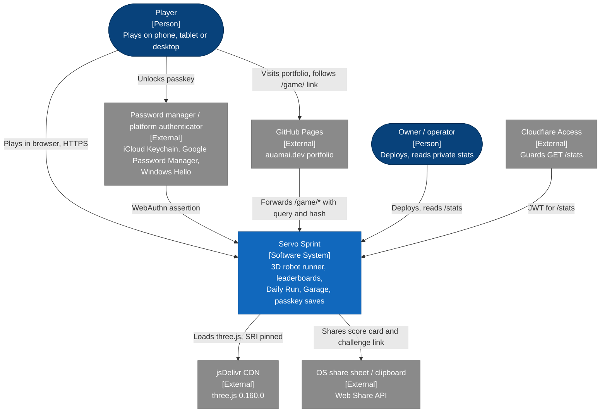

### 2.2 Containers (level 2)

```mermaid
flowchart TB
    player(["Player<br/>[Person]"])

    subgraph SS ["Servo Sprint [Software System]"]
        direction TB
        site["Static site<br/>[Container: Cloudflare Worker + static assets]<br/>servosprint Worker, www to apex 301,<br/>_headers: CSP, HSTS, caching"]
        client["Game client<br/>[Container: ES modules, three.js r160, Web Audio]<br/>Runs in the browser: sim, render, UI, audio"]
        ls[("localStorage<br/>[Container: browser storage]<br/>profile, settings, public summary")]
        api["Leaderboard API<br/>[Container: Cloudflare Worker]<br/>auamai-leaderboard at api.auamai.dev<br/>scores, profiles, passkeys, /err, /stats"]
        d1[("D1 database<br/>[Container: SQLite]<br/>auamai-leaderboard")]
        cron["Daily cron<br/>[Container: Worker scheduled 00:05 UTC]<br/>salt rotation, cleanup"]
        wk["Related-origins file<br/>[Container: Cloudflare Worker]<br/>auamai-webauthn on<br/>auamai.dev/.well-known/webauthn"]
    end

    cdn["jsDelivr<br/>[External]"]
    pm["Authenticator / password manager<br/>[External]"]
    gh["GitHub Pages auamai.dev<br/>[External]"]

    player -- "HTTPS GET" --> site
    site -- "Serves index.html, modules, assets" --> client
    client -- "import map, SRI" --> cdn
    client -- "Reads and writes JSON" --> ls
    client -- "fetch JSON, CORS allowlist, 5 s timeout" --> api
    client -- "navigator.credentials" --> pm
    pm -- "Fetches related origins for RP ID auamai.dev" --> wk
    wk -- "All other paths pass through" --> gh
    api -- "Prepared SQL" --> d1
    cron -- "DELETE expired rows, new salt" --> d1

    classDef person fill:#08427b,stroke:#052e56,color:#ffffff
    classDef container fill:#438dd5,stroke:#2e6295,color:#ffffff
    classDef store fill:#438dd5,stroke:#2e6295,color:#ffffff
    classDef ext fill:#8a8a8a,stroke:#6b6b6b,color:#ffffff
    class player person
    class site,client,api,cron,wk container
    class ls,d1 store
    class cdn,pm,gh ext
    style SS fill:#f4f8fd,stroke:#1168bd,stroke-dasharray:4 3,color:#0b4884
```

`/hit` (salted unique-visitor count) is called by the portfolio's `script.js`, not by the game (no `/hit` anywhere
under `game/` at `integration/r7`).

### 2.3 Components: game client (level 3)

`game.js` builds one `Game` object and mixes the classes from `src/` onto its prototype, so components below
are mixins sharing `this` rather than separate objects.

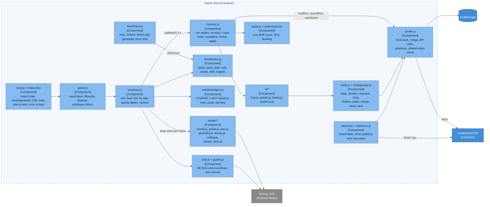

### 2.4 Components: leaderboard Worker (level 3)

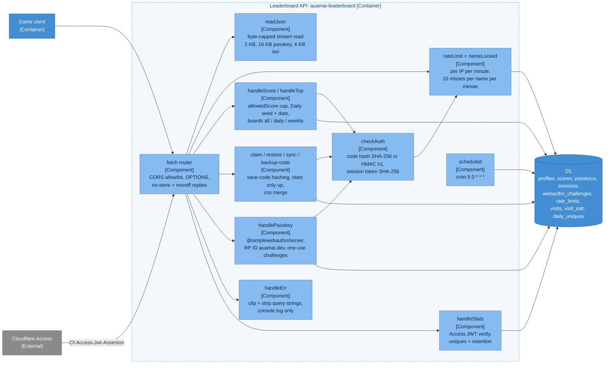

---

## 3. Deployment

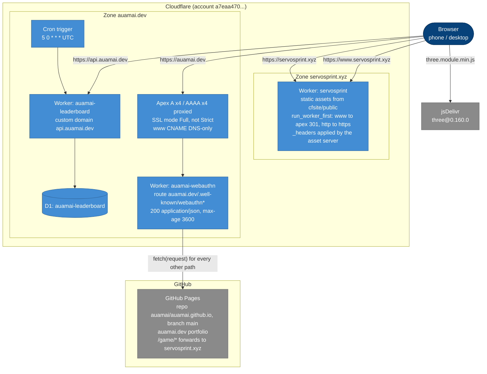

| Piece | Where | Notes |
| --- | --- | --- |
| Game | `servosprint` Worker with static assets, `cfsite/` (`wrangler.toml`: `[assets] directory = "./public"`, `run_worker_first = true`) | `cfsite/src/index.js` only redirects `www.servosprint.xyz` and `http:` to `https://servosprint.xyz` (path + query kept), then `env.ASSETS.fetch`. `workers_dev = true`, previews off |
| `_headers` | `game/_headers`, copied to `cfsite/public/_headers` | `deploy_assets.py` sends it as the assets config, not as a file |
| API | `auamai-leaderboard` Worker, custom domain `api.auamai.dev` | D1 binding `DB` (`auamai-leaderboard`, id `0088edc7-...`). No KV namespace is bound (D1 is the only storage binding in `wrangler.toml`). |
| Cron | `[triggers] crons = ["5 0 * * *"]` (00:05 UTC) | Rotates the visit salt; deletes old visits, rate-limit rows, expired WebAuthn challenges and sessions |
| Related origins | `auamai-webauthn` Worker, route `auamai.dev/.well-known/webauthn*` | Body `{"origins":["https://servosprint.xyz","https://www.servosprint.xyz","https://auamai.dev"]}`. The same list also lives in the repo's `.well-known/webauthn/index.json` on `main`: **update both** |
| Portfolio | GitHub Pages, `main` | `auamai.dev/game/*` forwards to servosprint.xyz with query and hash (PR #9, `e13bc75`): `game/index.html` on `main` is a static page that runs `location.replace("https://servosprint.xyz/" + location.search + location.hash)`, with a `<noscript>` meta refresh (query and hash lost there) and `noindex`. GitHub Pages has no server redirects. Old auamai.dev saves do not migrate (one-time import is a to-do) |

The `www.servosprint.xyz` 301 applies to every request because `run_worker_first` is set, so **www never renders
the game**: `cfsite/src/index.js` redirects every www request (any client) to the apex before the asset server sees
it, and every passkey ceremony runs on `https://servosprint.xyz`. `www` stays in `ALLOWED_ORIGINS`, `RELATED_ORIGINS`
and the `.well-known/webauthn` list only as a harmless fallback in case the redirect is ever removed.

`auamai.dev/.well-known/webauthn` is served 200 (no redirect) by the `auamai-webauthn` Worker route; the apex is
Cloudflare-proxied with SSL mode Full (not Full strict). Details: `webauthn-worker/README.md` in the working tree.

---

## 4. Sequence diagrams

### 4.1 Run to score submit

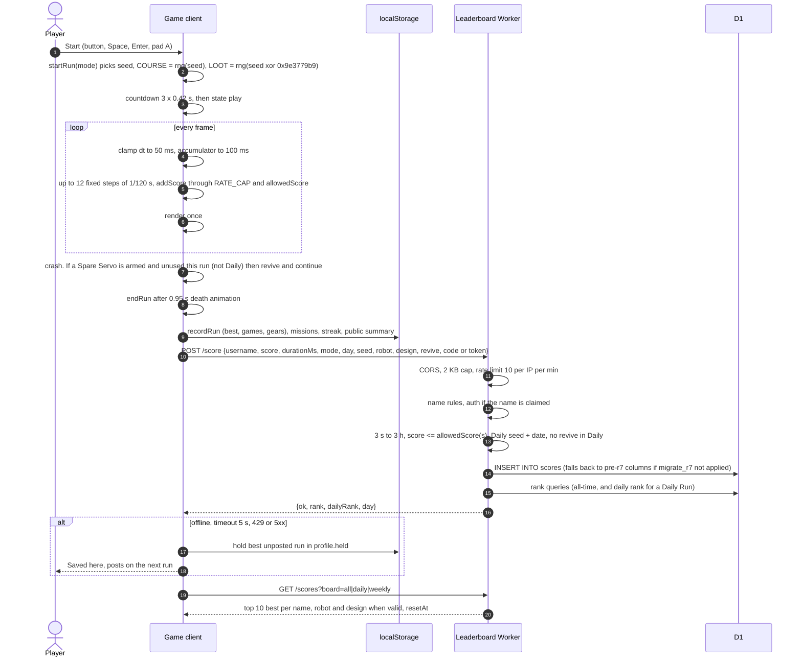

### 4.2 Passkey register and sign-in through related origins

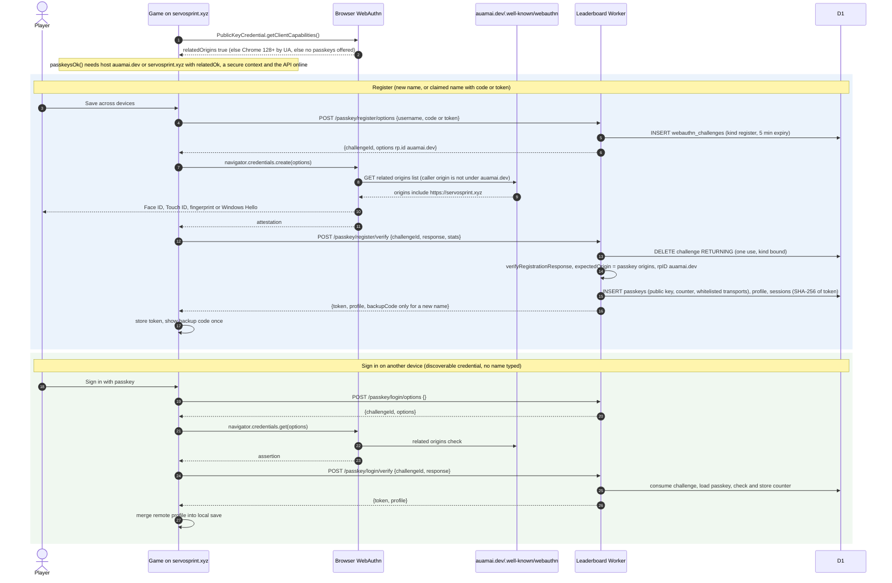

Passkey origins accepted by the Worker: every allowed origin under `*.auamai.dev`, plus
`RELATED_ORIGINS = ["https://servosprint.xyz", "https://www.servosprint.xyz"]`. Confirmed in the merged `passkeyOrigins()` (`leaderboard-worker/src/index.js`): it filters `allowedOrigins(env)`
to `*.auamai.dev` **or** `RELATED_ORIGINS`. Dropping the `RELATED_ORIGINS` term would silently break passkeys on
servosprint.xyz; keep it in any future conflict resolution.

### 4.3 Backup-code recovery

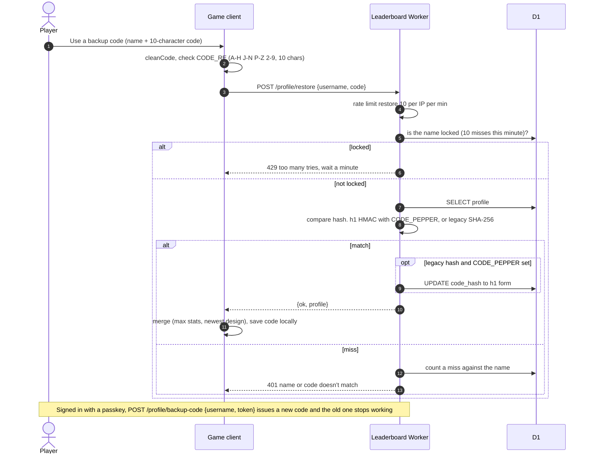

### 4.4 Challenge link

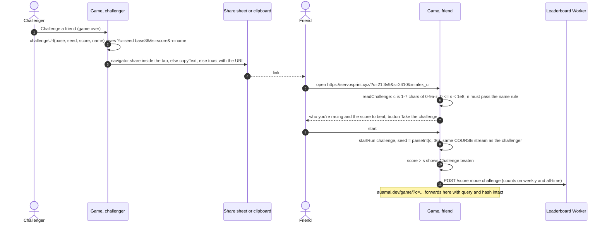

### 4.5 Profile sync

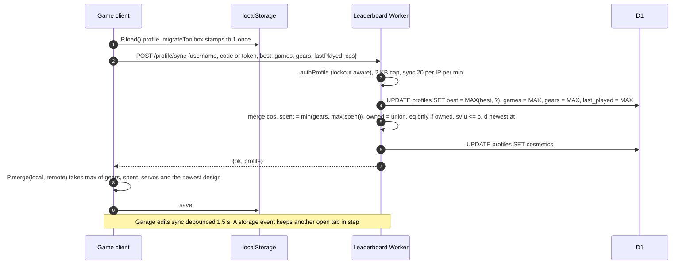

Server-side Spare Servo rule (`handleSync`, `3a2def8`): `bought = min(max(local.b, remote.b), floor(spent / 450))`,
then `bought <= used + SERVO_MAX` (3 held at once), and `used <= bought`. `SERVO_PRICE = 450`, `SERVO_MAX = 3`
mirror `game/meta.js` `SERVO`. A client cannot sync servos its spent gears did not pay for.

---

## 5. Module map

All paths under `game/`. Every local import carries `?v=<build>` (r7: `?v=20261021r7`, on all 124 local
references); bump it on every release, and keep the `modulepreload` list in `index.html` in step with the import graph.

| Path | Role |
| --- | --- |
| `index.html` | Page shell: meta/OG/JSON-LD, CSP `<meta>`, import map (three.js minified + SRI), modulepreload list, iOS web-app meta |
| `boot.js` | Boot script moved out of `index.html` so the CSP needs no inline script; holds its own `?v=` for `game.js` |
| `_headers` | Cache and security headers for the Cloudflare asset server |
| `manifest.webmanifest` | PWA manifest: `id`, `display_override`, maskable 512 icon, Daily Run shortcut |
| `robots.txt`, `sitemap.xml` | SEO for servosprint.xyz (assume `game/` is the site root) |
| `game.js` | Entry: `openGame()`, lifecycle, dispose; mixes the `src/` classes into `Game.prototype` |
| `config.js` | Public API base URL and `GAME_URL` only. No secrets |
| `src/core/constants.js` | All tuning and content tables (pure data). `visY()` drawn-height helper |
| `src/core/loop.js` | rAF loop, fixed step, adaptive quality, camera, menu frame cap on touch |
| `src/core/run.js` | Run lifecycle and rules: modes, countdown, pause, `addScore`, tools, multipliers, Overdrive, revive, death, `endRun` |
| `src/core/util.js` | `fmt`, `esc`, the `RNG` holder and `COURSE()` / `LOOT()`, `pick`, `shuffle` |
| `src/sim/physics.js` | Runner and roller physics: lane spring, jump buffer, slide, rails, ramps, drift, magnet |
| `src/world/worldgen.js` | Row spawning from COURSE, pickups from LOOT, pooled obstacles, rovers |
| `src/input/input.js` | Keyboard, swipes, wheel pad, gamepad (hysteresis), focus trap, blur/visibility/orientation/context loss |
| `src/render/render.js` | Scene, quality tiers, camera, trail, `applyDesign()`, Garage close-up |
| `src/render/grade.js` | Brand colour grade and light rig (AgX), UI-overlay lights |
| `src/render/arm.js`, `geometry.js` | Machined arm gantry (merged per material), shared geometries |
| `factory.js`, `ceiling.js` | The hall: floor, walls, zones, roof, signs (LINE 3, NO RUNNING, FOREMAN'S OFFICE) |
| `robots/` | `ul-h1.js` runner, `ul-w1.js` roller, `kit.js` shared materials and `bake()` (keeps UVs for `userData.keepUv`) |
| `tools.js` | Tool pickups, held props, particle bursts (0.6x on touch) |
| `ui3d.js`, `glyphs.js` | 3D hints and countdown on a separate transparent canvas (DPR cap 2); Inter Tight outlines incl. `+` |
| `src/ui/hud.js` | Score, gears, multiplier, tool chips (bitmask-keyed, DOM touched only on change) |
| `src/ui/panels.js` | Menu, game over, board, settings, save/claim/restore, Garage panels, `keepFocus()`; the settings row ends with a plain `<a>` "Player manual" link to `MANUAL_URL` (docs/MANUAL.md on the `robot-game` branch on GitHub, new tab, no script, CSP-neutral) |
| `src/ui/brand.js`, `sound-ui.js` | Wordmark; speaker button (tap mute, hold volume) |
| `src/meta/garage.js` | Missions strip, Garage, shop, badges, Spare Servo arming |
| `meta.js` | Vancouver calendar, Daily seed, `rng`, streaks, missions, `SHOP`, wallet + `spend`, `SERVO`, design code, profanity filter, near-miss, challenge URLs, share card, public summary |
| `profile.js` | Local profile + settings, merge, API calls, passkeys, related-origin check |
| `src/net/net.js` | Board fetch and tabs, share pipeline |
| `src/net/errors.js` | Error boundary, `POST /err` (message + build, no PII) |
| `audio.js`, `src/audio/sound.js` | Web Audio engine ("Line Shift", 106 BPM), SFX, ducking, iOS unlock |

Worker: `leaderboard-worker/src/index.js` (single module), `schema.sql`, `migrate_r6.sql`, `migrate_r7.sql`,
`test/security.test.mjs`, `wrangler.toml`.

---

## 6. Render pipeline and quality ladder

### Load path

`index.html` maps `three@0.160.0/build/three.module.js` to `three.module.min.js` with an import map
(about 88 KB less gzip over the wire), pins it with SRI, and modulepreloads every game module plus `game.css`. The
import graph downloads in **2 round trips instead of 6**. An extra preload entry costs a wasted request; a missing
one costs a later fetch.
There is exactly **one** import map. It carries both the min mapping and the SRI `integrity` entry for
`three.module.min.js` (`sha384-8/hf5tabFfIo0BPku31TKUvGIKpWGYaMwNtlSNqNyZzXgZCMd4lnOGWbJElML9dv`, which is the hash of
the minified file; the three.js `modulepreload` carries the same hash). The CSP allows the map by its sha256,
`sha256-5AgWD5gg2O0katLPS0tTlO+m4pWElLcBQVGYYxBhvtk=`, and that value is identical in the `<meta>` CSP in
`index.html` and in `game/_headers`; it matches the current map text byte for byte. Change one character of the map
and you must recompute the sha256 and update **both** places, or the browser refuses the map and the game won't load.

### Frame

1. `loop()` on rAF: clamp dt, run fixed steps ([§7](#7-fixed-step-simulation-120-hz)), poll the gamepad.
2. Update presentation: robot animation, camera, trail, particles, HUD (only on change).
3. `renderer.render(scene, camera)` once, shadow pass included when the tier has shadows.
4. `ui3d` renders hints and the countdown on its own canvas.

Colour: AgX tone mapping and the brand grade in `grade.js`. Palette is graphite `#14161B`, off-white `#F2F0EA`,
signal yellow `#FFC93C`, cyan `#3DDCFF` and their tints. No orange. Crushed blacks are lifted with a small
emissive floor on ceiling car bodies and hall solids (r6b).

### Quality ladder

| q | DPR cap | Shadows | Other |
| --- | --- | --- | --- |
| 0 | `min(devicePixelRatio, 2)` | on | full robot shaders |
| 1 | 1.75 | on | |
| 2 | 1.25 | off | lite robot kit (`useLiteKit`) |
| 3 | 1 | off | flat 2D hints instead of 3D |

- Steps down only in `play`, after the first 2 s, on two consecutive 2 s windows under 40 fps. Never steps back up
  within a run. The slow-window counter resets at the start of every run.
- `window.__frLockQuality` pins it (tests).
- **"lo" tier** (touch, or q >= 2): a cyan additive spill decal under the robot replaces the desktop hero
  PointLight, and `game.gearShadow` is false, so gears cast no shadows on phones.
- `resize()` is idempotent: keyed on width, height and DPR, so the three resize events per rotation don't each
  discard the drawing buffer. Anything that changes camera aspect or FOV must not rely on resize running.
- On coarse pointers the menu and game-over backdrop draws at about 30 fps (frames under 30 ms apart are skipped,
  dt accumulates). Runs, countdown and pause are untouched.

### Drawn height vs simulated height

A ramp launch is a true projectile (apex up to ~31 units at top speed, the roof is at ~9). `visY(y)` in
`constants.js` draws anything airborne at its true height up to 4.0, then eases (C1, exponential) toward 6.3, so the
robot stays under the trusses. Collisions, pickups, score and replays use the true height. The camera rises, eases
back and tilts with the drawn arc (70 % of the move on landscape/desktop, clamped at y <= 7.4).
**Rule:** anything new drawn in the air (flips, airborne pickups) must be drawn at `visY(y)`.

### Garage close-up

In the Garage the camera blends (`garageK`) to a close-up, studio fog and the far plane pull in (fewer draw calls
than the title), and the robot turns slowly (0.25 rad/s with reduce motion). `Render.applyDesign()` sets paint,
finish (roughness/clearcoat) and the chassis-plate CanvasTexture; the plate shares `kit.M.plate` with the back pack
and is baked into the same mesh (+0 draw calls). The texture is redrawn only when the design changes.

---

## 7. Fixed-step simulation (120 Hz)

| Constant | Value |
| --- | --- |
| `PHYS_HZ` | 120 (H = 1/120 s) |
| Frame dt clamp | 50 ms |
| Accumulator cap | 100 ms, at most 12 sub-steps per frame |
| Scale | 1 unit = 0.85 m (`M_PER_U`); robot 1.9 units = 1.6 m; lanes 2.2 units apart |
| Gravity | -9.81 m/s^2 = -11.54 u/s^2 |
| Jump | apex 1.65 units, v = 6.17 u/s, hang 1.07 s |
| Jump buffer `JUMP_BUF` | 0.3 s (runner and roller `Physics.hop()`) |
| Coyote time off a rail | 0.1 s |
| Lane spring | critically damped, 22 rad/s (runner), 34 rad/s (roller) |
| Slide | 0.72 s, entry skid with mu = 0.5 |
| Ramp | 35 degrees, lip 1.4 high, true projectile; `LAND_ROLL` 0.5 s invulnerable |
| Roller hop | apex 0.75 units |

- Input (keys, swipes, wheel pad, gamepad) is applied between steps, never inside one, so determinism is unaffected
  by frame rate. Tests show the same score at 60 and 144 Hz.
- Hit-stop (`HIT_STOP` 0.06 s) and the first-run hint slow-mo (`SLOW_T` 1.2 s to `SLOW_K` 0.4) scale dt inside
  the step and are switched off by reduce motion.
- The world scrolls toward the player; objects recycle within about ±170 units and scenery wraps every 12 units,
  so floats never drift far from the origin.
- Auto-pause on blur, hidden tab and orientation change; WebGL context loss pauses and stops drawing.
- **Revive:** `Run.revive()` returns obstacles within `REVIVE_CLEAR` = 30 units ahead (and the one hit) to their
  pools, sets `reviveT` = `REVIVE_T` = 1.5 s (part of the `invulnerable` getter), and the obstacle pass breaks
  after a revive because the list just changed. No-servo code paths are byte-for-byte the old ones.
- `fx.goldStep` (golden ladder callouts) and `passMilestone()` (badge moments, `Math.random` headlines) are
  presentation only and never read the course RNG.

---

## 8. Seeded RNG, determinism and golden replays

- **Generator:** a mulberry32-style 32-bit generator `rng(seed)` in `meta.js`.
- **Two streams per run** (`startRun`): `RNG.course = rng(seed)` lays out obstacles; `RNG.loot = rng(seed ^ 0x9e3779b9)`
  places pickups and steers rovers. What a player collects can never shift the course.
- **Seeds:** free runs `Math.random() * 2^32`; Daily `hash32("factory-run-daily:YYYY-MM-DD")` (FNV-1a, Vancouver date,
  identical on the Worker); challenge `parseInt(c, 36)`.
- `Math.random` is allowed only for presentation (headlines, particles, audio room IR), never in the sim.

### Golden replays

`r6b/golden.js` (+ `golden.py` driver) runs fixed seeds as challenge runs, records a heuristic bot's inputs by step
index, replays them, and digests state every frame (score, distance, robot x/y/lane, obstacle and gear sums, phase,
state). Expected values for this build:

| Scenario | Score / hash |
| --- | --- |
| `real_run` (17 s crash) | 432 / `acd66776` |
| `god_180s` (180 s, no deaths) | **9885 / `93ed983c`** (was 8353 / `e970d5ce` before the golden-wrench fix `bbb916c`) |
| `daily_like` (90 s clean) | 3057 / `ded68c93` |

The god_180s change is deliberate: the golden wrench picked up near 115 s now applies its multiplier and books the
next one. New expectations are in `review/gameplay_golden.json`. Any other sim change must either keep all three
or justify the new values in the PR. A Spare Servo is never used in the goldens.
All three goldens were re-run on the integrated tree (`integration/r7`, `b1ea002`) and match the values above:
`real_run` 432 / `acd66776`, `daily_like` 3057 / `ded68c93`, `god_180s` 9885 / `93ed983c`. Lighting's `worldgen.js`
change (`gearShadow`) is render-only.

---

## 9. Difficulty curve

- **Speed:** `min(38, 13 + 0.32 t)` units/s (11 to 32 m/s), top speed at about 78 s. Roller Mode moves the world
  at 1.2x. First run (`tutorial`): starts at 9.5 and smoothsteps onto the normal curve over 16 s.
- **Difficulty** `diff = (speed - 13) / 25`, 0 to 1.
- **Row spacing:** `max(14, 0.62 v) + U(0, 10)` (x1.35 in the tutorial); rover rows `max(16, 0.7 v) + U(0, 10)`;
  roller rows `max(18, 0.7 v) + U(0, 8)`.
- **Obstacles per row:** two with probability `0.35 + 0.35 diff` (never in the tutorial), else one. Never three.
- **Types:** `diff < 0.15`: crate, gap, arm. Above: crate, gap, arm, stack, stack (stacks weighted x2).
- **Rovers** from 20 s: a rover row with probability `0.18 + 0.32 diff`; two rovers when `diff > 0.45` (40 %).
- **Pickup timing:** tools from 10 s (25 s in the tutorial), at least 8 s apart and 20 s between two of the same kind,
  30 % per eligible row. Wheel tokens from 14 s, at least 28 s apart, 16 % per row. Golden wrench: first at
  `U(60, 120)` s from LOOT, the next 60 to 120 s after pickup, or 2.5 s after passing the PB (never while learning).

---

## 10. Obstacles and world generation

| Type | Counter | Hitbox notes |
| --- | --- | --- |
| `crate` | jump, lane change, hammer (+75) | single crate; 35 % of crate rows carry a 5-gear arc over it |
| `stack` | lane change, hammer (+75) | two high, cannot be jumped |
| `arm` | slide under the laser line, lane change, drill (+50) | rigid gantry from `arm.js` |
| `bot` (rover) | jump, lane change, hammer (+75) | low AMR driving at `BOT_SPEED` 3.2 on top of the belt; slows to belt speed behind something in its lane |
| `gap` | jump, lane change | hole in the line; falling ends the run |

**Fairness rules** (tested by `fairness_rows`, `ramp_arc`, `rail_grind`):
- Never three lanes blocked in a row. Rovers get their own rows so they can't close the last open lane.
- Pickups only in lanes empty in that row.
- Roller rows: one obstacle, never an arm (the roller can't slide), plus a rail or a ramp; no obstacle placed near a
  rail's end; gear lines follow the analytic ramp arc for the speed you'll hit it at.
- Ramp flight and the 0.5 s landing roll are invulnerable; morphs are invulnerable; 1.2 s grace after Roller Mode.

Everything is pooled (obstacles, gears, tools, rails, ramps, debris, popups); 3D strings get one cached geometry.

---

## 11. Scoring, caps and anti-cheat

### Points

| Source | Points |
| --- | --- |
| Distance | `0.5 x mult` per unit |
| Gear | `10 x mult` |
| Screw | `25 x mult` |
| Drill through an arm | `50 x mult` |
| Hammer through crate, stack or rover | `75 x mult` |
| Drift combo cash-out | `pool x (DRIFT_MULT[level] - 1)`, `DRIFT_MULT = [1, 1.2, 1.4, 1.6]` |

`mult = min(6, gold x overdrive)`, with `gold = 2 + floor(goldAge)` capped at 5 while `fx.gold > 0` (10 s) and
`overdrive = 2` for 8 s. Any contact (a smash, or passing through while invulnerable) ends gold. Roller Mode has no
flat multiplier any more (`DRIVE_MULT = 1`); it earns through rails, ramps and drift. Drift: lane changes within
`DRIFT_CHAIN` 0.6 s raise the level (max 3); the pool is cashed `DRIFT_CASH` 1.5 s after the last one.
(The stale "rolling ×1.5" text in `game/README.md` and the `run.js` comment was removed at integration, `6ef3a84`.)

Toolbox meter: `METER_N` = 10 (five segments of 2). A tool adds 2; the first smash of each drill/hammer adds 1.
Full meter starts Overdrive.

### Caps (client and Worker, identical)

```
RATE_CAP = 1200 points in any 1 s window (0.1 s buckets, current + 10 previous)
allowedScore(s) = 180 s + 50 + min(8000, max(0, s - 10) x 800)
```

`addScore` clips every addition to both. A perfect bot averaged ~112/s with a best 1 s window of 1,014.

### Worker checks on POST /score

- Body <= 2 KB, rate limit 10 per IP per minute.
- `durationMs` integer, 3 s to 3 h; `score <= allowedScore(durationMs / 1000)`.
- Daily: `day` must be today in Vancouver or the day the run started (across midnight, 60 s slack) and `seed` must
  equal `dailySeed(day)`. `revive: true` on a Daily is rejected.
- A claimed name needs its code or a session token.
- `robot` / `design` are sanitised (regex, profanity list) and dropped when bad, never an error.
- Design code: `/^[0-3][0-2][0-3][01][A-Z0-9-]{0,8}$/` (paint, finish, pattern, accent, plate).

### Limits of the model

The client decides the score. The server cannot tell a real run from a forged one inside the caps: a forged run
claiming 3 hours can post about 1.9M. `revive` is client-claimed. Sync stats (best, games, gears) are client-claimed
and capped at 100M (private, not used for the board).

**Planned:** server-issued run tickets (`POST /run/start` returns a ticket; `/score` checks the elapsed wall time
against `durationMs`), or replay verification using the deterministic sim (seed + input log). Not in this build.

---

## 12. Storage

### localStorage (client)

| Key | Contents |
| --- | --- |
| `au_factory_profile_v1` | `{ username, best, games, gears, lastPlayed, code?, token?, passkey, claimed, held, tb, cos }`. `held`: best unposted run `{score, durationMs}`. `tb: 1`: Toolbox migration stamp. `cos`: `{ spent, owned[], eq{trim,trail,hammer}, sv{b,u}, d{name,code,at} }` |
| `au_factory_settings_v1` | `pad`, `lefty`, `haptics`, `music`, `sfx`, `musicVol`, `sfxVol`, `tips`, `trim`, `missions[]`, `streak{n,last,freeWeek,usedFree}`, `dailyBest{day,score}`, `pbStreak`, `rank`, `still` (reduce motion; absent = follow OS), `servoArm` |
| `au_factory_public_v1` | Read-only summary for the portfolio teaser: `{v, name, best, rank, streak, dailyDay, dailyResetAt, dailyBest, weeklyResetAt, updatedAt}`. Never contains the code or token |

- `code` and `token` are secrets; nothing outside the game may read them.
- Every read and write is in try/catch (private mode plays on without saving).
- **Wallet** = `gears - cos.spent` (`MT.wallet`). `MT.spend()` re-reads the stored profile, merges (max of gears,
  spent, servos; newest design), checks, applies and saves in one synchronous task. Only the requested confirm row
  can spend, once. A `storage` listener keeps an open Garage in step.
- `MT.migrateToolbox` is idempotent and changes no balance.
- `cos.sv`: `b` bought and `u` used only grow, so merges take the max; servos held = `b - u`, max 3.

### D1 (server)

| Table | Key columns |
| --- | --- |
| `profiles` | `username` (PK, NOCASE), `code_hash`, `best`, `games`, `gears`, `last_played`, `created_at`, `updated_at`, `cosmetics` (JSON) |
| `scores` | `id`, `username`, `score`, `duration_ms`, `created_at`, `mode` (free/daily/challenge), `day`, `week`, `robot`, `design`, `revive` |
| `passkeys` | `cred_id` (PK), `username`, `public_key`, `counter`, `transports`, `created_at`, `last_used` |
| `sessions` | `token_hash` (PK, SHA-256), `username`, `created_at`, `expires_at` (400 days) |
| `webauthn_challenges` | `id`, `challenge`, `kind`, `username`, `expires_at` (5 min, deleted on read) |
| `rate_limits` | `key` (hash of bucket + IP or name + minute), `win`, `count` |
| `visit_salt`, `visits`, `daily_uniques` | Portfolio unique-visitor count (salted hashes, 30 days) |

Indexes: `idx_scores_score`, `idx_scores_user`, `idx_scores_daily (mode, day, score DESC)`,
`idx_scores_week (week, score DESC)`, `passkeys_by_user`, `sessions_by_user`, `idx_rate_window`.

### Migrations

| File | Adds | Notes |
| --- | --- | --- |
| `schema.sql` | Base tables | Every statement is `CREATE ... IF NOT EXISTS` |
| `migrate_r6.sql` | `scores.mode`, `day`, `week`; daily and weekly indexes; `profiles.cosmetics` | Applied in production at r6 |
| `migrate_r7.sql` | `scores.robot TEXT`, `scores.design TEXT`, `scores.revive INTEGER NOT NULL DEFAULT 0` | **Apply before deploying the r7 Worker.** The Worker falls back to the old insert/select if the columns are missing, so order isn't fatal, but robot names won't show |

```sh
npx wrangler d1 execute auamai-leaderboard --remote --file=./migrate_r7.sql
```

`ALTER TABLE ... ADD COLUMN` is not idempotent in SQLite: run each migration once.
The fallback in `handleScore` and `handleTop` runs only when `noColumn(e)` matches
(`/no such column|has no column named/i`); every other D1 error is rethrown and the request fails. (`3a2def8`)

---

## 13. Security

### Static site

- **CSP** (meta in `index.html` for GitHub Pages, header in `_headers` for Cloudflare):
  `default-src 'self'; script-src 'self' https://cdn.jsdelivr.net 'sha256-<import map>'; style-src 'self' 'unsafe-inline';
  img-src 'self' data: blob:; font-src 'self'; connect-src 'self' https://api.auamai.dev; media-src 'self' data: blob:;
  manifest-src 'self'; worker-src 'self' blob:; object-src 'none'; base-uri 'none'; form-action 'self'`, plus
  `frame-ancestors 'self'` in the header only. `style-src` keeps `'unsafe-inline'` because the UI sets inline styles.
  No inline script: the boot code lives in `boot.js`; the import map is allowed by its sha256.
- **SRI:** three.js 0.160.0 pinned by `integrity` in the import map. A wrong hash shows the boot error screen.
- **Headers** (`_headers`, every path): `X-Content-Type-Options: nosniff`, `Referrer-Policy: strict-origin-when-cross-origin`,
  `X-Frame-Options: SAMEORIGIN`, `Strict-Transport-Security: max-age=31536000; includeSubDomains` (no preload),
  `Permissions-Policy: camera=(), microphone=(), geolocation=(), payment=(), usb=()`, `Cross-Origin-Opener-Policy: same-origin`.
  Cache: `*.js`, `*.css`, `/fonts/*` immutable for a year; `/brand/*` one day; `/`, `index.html`, manifest `no-cache`.
- **Rule:** if the import map or the three.js version changes, update the SRI hash **and** the CSP `sha256-...` in
  both `index.html` and `_headers`. `?v=` bumps are safe.
- XSS: every server or URL value goes through `esc()`; toasts use `textContent`; the share card is canvas-drawn;
  challenge `n` is re-checked against the name rule.

### API

- **CORS allowlist** `ALLOWED_ORIGINS`: `https://servosprint.xyz, https://www.servosprint.xyz, https://auamai.dev,
  https://www.auamai.dev` (`servosprint.auamai.workers.dev` only while a preview is in use). `auamai.github.io` is gone.
- Replies: `Cache-Control: no-store`, `nosniff`, `CSP default-src 'none'; frame-ancestors 'none'`; `/scores` is
  `public, max-age=15`. `?board=` is normalised to `all | daily | weekly`.
- **Body caps** (bytes, streamed): 2 KB; 16 KB for passkey routes; 4 KB for `/err`.
- **Rate limits** per IP per minute: score 10, claim 5, restore 10, sync 20, passkey 20, backup-code 5, err 20, hit 30.
  **Per-name lockout:** 10 wrong codes or tokens per name per minute from any IP, then 429 ("too many tries, wait a
  minute"), even for the right code. Trade-off: someone who knows a name can lock it a minute at a time.
- **Save codes:** 10 chars from `A-H J-N P-Z 2-9` (~50 bits), shown once. Stored as legacy `SHA-256` or, when
  `CODE_PEPPER` is set, `h1:` HMAC; legacy hashes upgrade on next use.
- **`CODE_PEPPER` rule:** optional Worker secret (>= 16 random chars, `wrangler secret put CODE_PEPPER`). **Do not set it
  without the owner. Once set, never change or remove it**: every upgraded code would stop matching and those players
  would need a passkey to mint a new backup code.
- **Sessions:** 256-bit tokens, stored as SHA-256, 400-day expiry. A new backup code does not revoke other sessions;
  there is no sign-out-everywhere yet.
- **Passkeys:** RP ID fixed `auamai.dev`; challenges one-use (deleted on read), 5-minute expiry, kind-bound;
  counters checked and stored; `transports` whitelisted to WebAuthn names.
- **Sync:** shop ids in `eq` must be in `owned`; `spent <= gears`; `sv.u <= sv.b`.
- **/stats:** Cloudflare Access plus the Worker's own JWT check (`ACCESS_TEAM_DOMAIN`, `ACCESS_AUD`); denies all while empty.
- **/err:** fields clipped, URLs stripped of query and hash, logged with `console.log` only (not stored in D1).
- No secrets in the repo or the client (`config.js` holds only the public API URL).

---

## 14. Audio graph

All synthesised at run time (`audio.js`): "Line Shift", fixed 106 BPM Afrobeat with a sax lead, plus SFX. No samples.

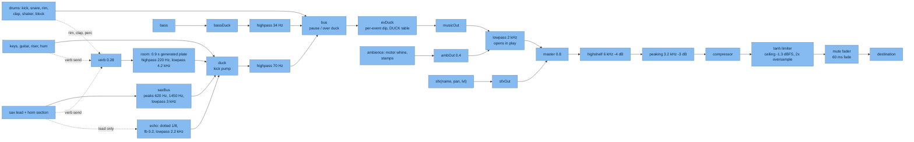
Routing as wired in `audio.js` `init` and the voice functions: the countdown `tick` goes straight to `musicOut`, so it
skips the bus ducks.

- **Ducking:** `duckFor(db, hold)` per event from the `DUCK` table: crashes and hit 7 dB, fall 7 dB, PB 5 dB,
  Overdrive 3.5 dB, power 3 dB, tool 2 dB, golden step `mult` 1.5 dB. SFX stay on top.
- **`mult` SFX:** rising chime per golden step, fired from `loop.js`, audio only (never touches the sim).
- **iOS:** `unlock()` only from pointerdown/keydown; the first gesture also starts a 1-sample silent buffer;
  `navigator.audioSession.type = "ambient"` so the ringer switch mutes it. Suspended while hidden.
- Mute and volumes persist in settings; **M** toggles music.

---

## 15. Performance budgets

| Budget | Target | This build |
| --- | --- | --- |
| Payload (gzip, game js/css/html, excl. three.js) | +15 KB per review branch | **+20.15 KB gzip** page load vs `1e03708` (measured on `integration/r7` by the integrator; base 157.3 KB, so about **177 KB**). Per branch: garage +10.1, growth +2.7, lighting +1.5, perf +1.0, security +0.3, others small |
| three.js | minified r160 over the wire **−88 KB gzip** vs unminified (measured at integration) |
| Round trips to first frame | 2 | 2 (modulepreload) |
| Hot loop allocations | 0 per sub-step | HUD chips keyed by bitmask; revive and spend allocate once per event |
| Robot meshes | 58 | 58 |
| Draw calls, in a run | see below | see below |

### Draw calls: the honest numbers

`renderer.info` summed over every `renderer.render` in a frame, shadow pass included.

| Situation | Phone | Desktop |
| --- | --- | --- |
| Early run (2 to 2.5 s), median | ~130 to 135 | ~146 to 157 |
| Busy mid-run, shadows on | ~225 to 275 | ~225 to 275 |
| Garage close-up | 115 to 125 | 132 to 135 |

The old "152" budget was measured 2 s into a run and does not hold mid-run: busy frames reach **~225 to 275**, of which
**+50 to 74** is the shadow pass. Integrated build (`integration/r7`, `b1ea002`): median draw calls **phone 138, desktop 155**.
A perf-instancing pass (instance gears and screws, merge obstacle meshes) on the integrated build is in progress
on `review/instancing`.

> **TODO (perf-instancing):** replace this note with the instancing pass's measured numbers (early-run median,
> busy mid-run with shadows, Garage close-up; phone and desktop) and its commit, in the same PR that merges it.

Not yet measured on this box (2 CPUs, shared): 4x CPU-throttle p95 frame time, Fast-3G first frame, a 30-minute soak
at full speed. These need a quiet machine or a real phone before release. The 10-minute soak at r6d showed 0 errors
and stepwise heap growth consistent with pools warming (19.7 to 22.2 MB).

---

## 16. Accessibility

- **Reduce motion:** `.fr.is-still` on the root is the single switch. Source: `settings.still` when set, else
  `prefers-reduced-motion`. Live: shake, hit-stop, hint slow-mo, score count-up, UI transitions, Toolbox fly-in off;
  the "+25" score text fades in place; Garage turntable slows to 0.25 rad/s.
- **Screen readers:** one live region. Announces the countdown, tips, best, Overdrive, golden steps and finish,
  milestone badges, "Spare Servo. Rebooted.", and at run end the cause, score and best. Badge group and rank arrow
  use valid ARIA.
- **Keyboard:** focus trap inside the overlay; `keepFocus(region, swap)` for partial re-renders so focus never falls
  to `<body>` (where Space starts a run); leaderboard tabs are one Tab stop (roving tabindex, arrows, Home, End);
  every control shows the cyan focus ring; Space/Enter run again even with "Run again" focused.
- **Touch targets:** >= 44 px for every button, link, switch, tab, badge and slider, via an invisible `::after` hit
  area where the visual is smaller.
- **Flashing:** under 3 flashes per second (revive rings breathe at ~1.3 Hz; golden pops once a second).
- Contrast: dark UI, AA text. Numbers use one `en-US` formatter (localised formats are open).

---

## 17. Testing

| Suite | Where | Count | What |
| --- | --- | --- | --- |
| Golden replays | `r6b/golden.js`, `golden.py` | 3 | `real_run`, `god_180s`, `daily_like`; per-frame digests ([§8](#8-seeded-rng-determinism-and-golden-replays)) |
| Browser suite | `r6/tests.js` (+ `tests.py`), headless Chromium, touch emulation | **17** | fairness, caps, multipliers, magnet reach, smash rules, rail grind, ramp arc, drift combo, Daily same course, streaks + missions, PB moment, near-miss, teaser key, jump physics, fixed timestep (60 vs 144 Hz), lane spring, wheel touch |
| Reliability suite | `r6b/tests_b.js` (+ `tests_b.py`) | **9** | fuzz input, dt clamp, WebGL context loss, error boundary, gamepad, speaker button, share + challenge, Garage/Daily board, iOS audio guard |
| Garage tests | `review/garage_shots/gtests.py` | 11 | wallet migration, spend, insufficient, two tabs, confirm row, design sanitise, revive once, revive flag, revive off in Daily, draw calls, breakdown |
| Worker: security | `leaderboard-worker/test/security.test.mjs` (`npm test`, Node 22+ for `node:sqlite`) | 46 | caps, lockout, pepper, body caps, CORS, headers, transports, sync rules |
| Worker: garage | `review/garage_shots/wtest/test_worker_garage.mjs` (outside the repo) | 14 | robot/design sanitise, old shapes, revive flag and Daily rejection, servo clamp, unmigrated fallback |
| Worker: garage fixes | `leaderboard-worker/test/garage_fixes.test.mjs` (in the repo, run by `npm test` after `security.test.mjs`) | 12 | servos capped by spent gears (450 each, max 3 held), fallback only on a missing column, whole-word name filter (Sussex/Dickens pass), robot name can't equal another username |
| Worker: legacy | `worker/test_r6.mjs` 15, `test_r6b_err.mjs` 9, `test_r4r5_on_r6.mjs` 31 | 55 | earlier rounds run against the new bundle |

**Gates for any PR:** goldens identical (or justified), 17/17, 9/9, Worker suites green, zero console errors on phone
(390x844 DPR 3, touch) and desktop (1280x800), no orange/periwinkle pixels in title and run screenshots, payload within
budget. Harness and logs live outside the repo (`/workspace/work/robotgame/review/val_h/`, `sec_h/`, `garage_shots/`).
At `integration/r7` only the two `leaderboard-worker/test/` suites are in the repo. The garage browser tests
(`gtests.py`, 11) and the Worker garage suite (14) still live under `review/garage_shots/`; moving them into the repo
is open. Integrated Worker total: **134** (31 + 15 + 9 + 14 + 46 + 12 + 7, as counted by the integrator). Browser
17/17, reliability 9/9, garage 11/11 on `b1ea002`.

Known test gaps: no WebKit on the test box (iOS covered by Chromium emulation plus code review); a real iPhone pass
is needed for audio unlock, share sheet and Add to Home Screen.

---

## 18. Deploy and rollback

### Order for r7

1. **D1 migration:** `npx wrangler d1 execute auamai-leaderboard --remote --file=leaderboard-worker/migrate_r7.sql`.
2. **API Worker:** build the bundle (`npm run build` gives `dist/index.js` with `@simplewebauthn/server`; or
   `npx wrangler deploy`). From the sandbox, `worker/deploy.py <name> <d1-id> <origins> [ACCESS_AUD] [ACCESS_TEAM_DOMAIN]`
   PUTs `worker/bundle.js` with bindings. **`deploy.py` ignores `wrangler.toml`**, so pass
   `https://servosprint.xyz,https://www.servosprint.xyz,https://auamai.dev,https://www.auamai.dev` as origins.
   `CODE_PEPPER`: leave unset unless the owner decides (see [§13](#13-security)).
   `deploy.py`'s metadata carries no triggers. Cloudflare stores cron triggers separately from the script (Workers
   Schedules API), so a script PUT should leave `5 0 * * *` in place, but check it under the Worker's **Triggers**
   after every deploy. If it is missing, restore it with
   `PUT /accounts/<id>/workers/scripts/auamai-leaderboard/schedules` and body `[{"cron":"5 0 * * *"}]`.
3. **Static site:** copy `game/` into `cfsite/public/` (including `_headers`, `robots.txt`, `sitemap.xml`, the maskable
   icon), bump `?v=` everywhere, then `python3 cfsite/deploy_assets.py`. It uploads assets through an upload session
   (direct, with the session JWT, because the sandbox gateway rewrites the Authorization header that wrangler needs),
   sends `_headers` in the assets config, and PUTs `cfsite/src/index.js`.
4. **Related origins** (only if origins change): update both `webauthn-worker/index.js` (`auamai-webauthn`) and
   `.well-known/webauthn/index.json` on `main`.
5. **Verify live:** title, a driven run, score POST 200 with the CORS origin echoed, Share, challenge `?c=21i3v9`,
   Daily `?daily=1`, Garage, passkey register/sign-in on apex and www, response headers (CSP, HSTS), zero console errors.

### Rollback

| Piece | How |
| --- | --- |
| Static site | Redeploy the previous `cfsite/public` snapshot with `deploy_assets.py`, or roll back the `servosprint` Worker version in the Cloudflare dashboard. No per-release snapshot of `public/` is kept today: tag each release commit (for example `servo-r7`) before
deploying, so `game/` at the previous tag is the rollback snapshot |
| API Worker | `deploy.py` with the previous bundle (`worker/bundle_r6b.js`, `bundle_ror.js` are kept), or dashboard version rollback. The r7 columns can stay; older Workers ignore them |
| D1 | `migrate_r7.sql` is additive; no rollback needed. Use D1 Time Travel for data restores |
| auamai-webauthn | PATCH each apex A/AAAA record to `proxied: false`, DELETE the route `1a618d56...`, optionally delete the script. GitHub's own file keeps working (301 to `/webauthn/`, then 200) |
| `CODE_PEPPER` | Cannot be rolled back once codes are upgraded. Never remove it |

---

## 19. Keeping these docs current

**Rule:** every PR or commit that changes gameplay, UI, storage, the API or the architecture updates
`docs/MANUAL.md` and/or `docs/ARCHITECTURE.md` in the same PR. Reviewers block merges that don't.

| If you change... | Update |
| --- | --- |
| A tuning constant, power-up, obstacle, multiplier, scoring source | MANUAL (Scoring / Power-ups / Obstacles) and ARCHITECTURE §9-§11 |
| Controls, settings, accessibility behaviour | MANUAL (Controls / Settings) and ARCHITECTURE §16 |
| Missions, shop items, prices, Garage options | MANUAL tables and `meta.js` reference in ARCHITECTURE §5/§12 |
| A localStorage key or field, a D1 table or column, a migration | ARCHITECTURE §12 (and MANUAL Privacy if it's personal data) |
| An endpoint, request/reply shape, rate limit, cap | ARCHITECTURE §4, §11, §13 |
| Hosting, domains, Workers, routes, deploy scripts | ARCHITECTURE §2, §3, §18 |
| Render tiers, draw calls, payload | ARCHITECTURE §6, §15 with measured numbers |
| Golden expectations | ARCHITECTURE §8 with the reason |

Diagrams are Mermaid in this file: edit them as text in the same PR. Mark anything not yet checked against the code with `<!-- VERIFY -->` and remove it once confirmed.
